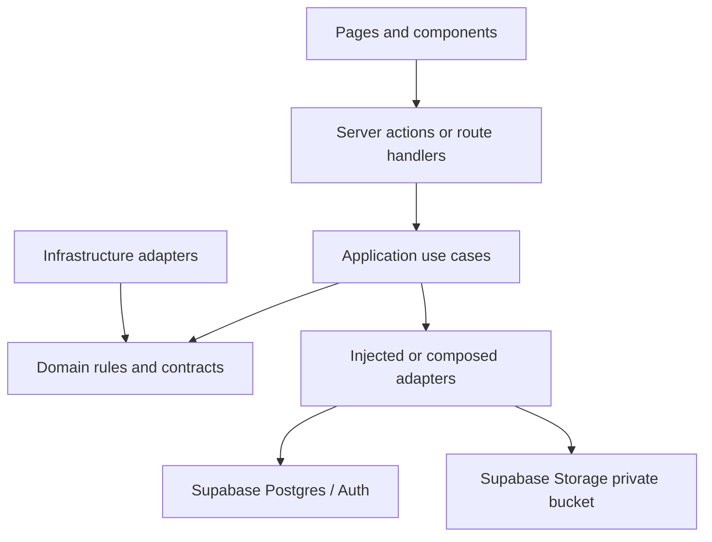

# Architecture and dependency boundaries

Single deployable full-stack Next.js App Router, Supabase PostgreSQL/Auth/Storage, hosted on Cloudflare Workers. Product media uses a private Supabase Storage bucket. Modular monolith; feature boundaries follow products, cart, checkout, orders, inventory, customers, reviews, media and administration. No duplicate data store or separate server at launch.

Environment boundary: development and testing target the isolated UAT Supabase project; the `main` release target uses a separate live project. Both use the same ordered migrations and private `product-media` bucket configuration, with independent objects. Only synthetic fixtures belong in UAT. App and deployment connections still require environment-specific configuration. See [ENVIRONMENTS.md](ENVIRONMENTS.md) for setup and release gates. Never select the database or environment based on client-supplied values.

## Dependency model

Domain rules have no React, Next, network or database dependency. Use pure functions for money/variants/transitions. Use cases coordinate authorization and persistence. Adapters implement narrow contracts where substitution or testing warrants them; straightforward read queries need not use elaborate generic repositories. Compose concrete dependencies at server entry points. Do not duplicate transaction-critical rules in TypeScript alone: SQL is authoritative for atomic operations.

## Boundaries
| Concern | Location | Constraint |
|---|---|---|
| Route/layout | src/app | Compose UI, metadata, server entry points; no duplicated business logic |
| Domain UI | features/*/components | Props/events; no privileged DB access |
| Common UI | components/ui, shared | Domain-neutral, accessible; no feature imports |
| Domain | features/*/domain | Invariants and pure types/functions |
| Validation | features/*/schemas | Zod parses untrusted input; never trust client totals |
| Use cases | features/*/server | server-only auth, orchestration, query/repo |
| Shared server | server | cross-feature transactions, auth, provider plumbing |
| Infra | lib/supabase | Typed clients, secrets isolated; no client imports |
| Persistence | supabase/migrations, config.toml | versioned schema, Storage policies, grants, constraints, RPC and bucket limits |

Server Components by default. Client components for cart, filters requiring interaction, forms, motion and WebGL. Read public data server-side with bounded caching; protected data never shared-cache. Server actions/handlers validate identity, authorization and input independently; auth layout not a sole control. Client state holds only UI and local cart; URLs hold filter/search state; server owns prices, inventory, orders, reviews. Generated DB types belong in types/ and should not leak raw privileged records. Use DTOs with minimal fields.

## Admin and inventory

The `/admin` route group uses Supabase SSR cookies refreshed in `src/proxy.ts`; the proxy is not the authorization boundary. Server pages and actions call `requireStaff`, and RLS checks the same active owner/staff membership through `public.has_admin_role`. Staff assignments are stored in `public.staff_members`, not editable Auth metadata. Inventory changes call the `adjust_inventory` RPC, which locks a variant row, prevents reductions below reserved stock and records an `inventory_movements` row atomically. Shopper availability is generated from active status and on-hand minus reserved quantity. Order reservation, dispatch and cancellation transitions remain Stage 4.

## Checkout flow
Client sends variant IDs/qty and contact/delivery data plus idempotency key -> server authenticates or establishes guest context, validates input and computes quote -> SQL transaction persists order/items snapshot -> authorized summary -> customer clicks encoded WhatsApp link -> staff manually confirms through atomic reservation RPC. Dispatch consumes reservation and stock once; cancellation before dispatch releases once. Concurrency and duplicate calls must be tested in Postgres. External link is not payment or proof of message delivery.

## Extensibility
Use separate checkout mode and payment provider availability. No fake provider implementations. Define small future payment contracts when actual need arrives (create session, verify callback, status/refund capabilities as supported). A registry must deny unimplemented/unconfigured/unverified providers despite UI switches. Keep credentials server-side; never store raw card data. Record significant design decisions as ADRs.
